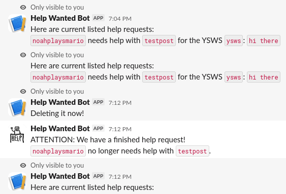

# Help Wanted Bot
A simple slack bot to track who needs help with their projects.

# Commands
 - `/help-wanted-bot-list`: Lists active help requests.
 - `/help-wanted-bot-ping`: Say hello to the bot!
 - `/help-wanted-bot-search [search term]`: Search for requests.
 - `/help-wanted-bot-done [title]`: Marks a request you made as
    finished and removes it from the list (Doesn't work for
    someone else's request).
 - `/help-wanted-bot-post [title] [ysws name] [description]`: Posts
    a request (The description can include spaces).

# How to run
1. Set up the slack bot on the website, and then put environment
    variables in `.env` for `SLACK_BOT_TOKEN` and `SLACK_APP_TOKEN`.
2. Run `npm install` to install the app's dependencies.
3. Run `node index.js` to run the bot.

# How it works
Every hour, the bot posts a list of the current active requests
to the entire channel. In between, it posts updates every time
a request is created or finished. The bot stores the last time
it posted an update in the file `last_advertisement`, so it
doesn't keep reposting if it gets restarted.

The bot stores the list of requests in `jobs.json`. This is fine
since this bot won't be accumulating crazy amounts of data or
anything, so at least at the current scale, we don't need a SQL
database or something similar.
